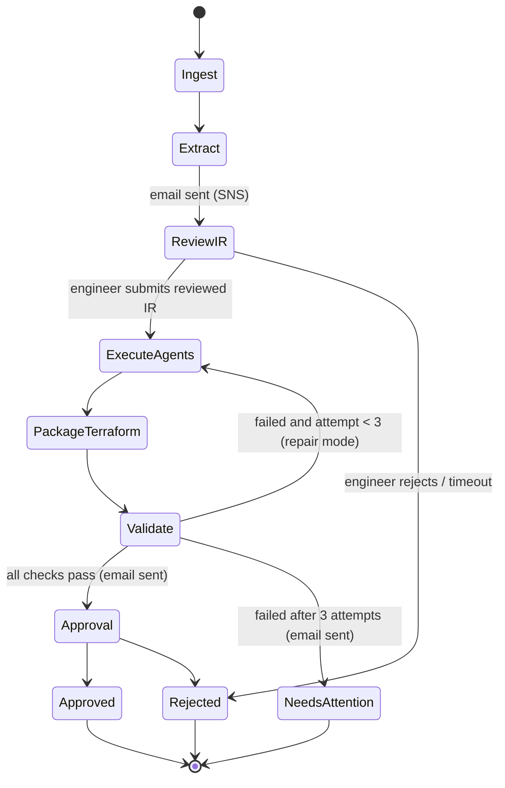

# Agentic Architecture Diagram-to-Infrastructure Engine: Solution Design

Status: **Draft v0.1** (Week 1, Discovery & Solution Design)
Scope: PoC up to and including **Human Approval**. Nothing is applied to any account.

---

## 1. Purpose and scope

The engine turns an AWS architecture diagram (PNG/JPG/PDF) plus deployment parameters into Terraform that:

- uses **only** modules from our Approved Module Registry, at pinned versions;
- passes `terraform validate`/`plan`, OPA policies, tflint and checkov;
- is reviewed by an engineer (IR review) and approved by a person (final approval), with all evidence retained.

The guiding principle is **"AI interprets the architecture, deterministic tools generate the infrastructure."** LLMs extract and reason over the diagram and pick modules and parameters. They never write raw HCL. Every HCL line is rendered by code from an approved module template and checked against that module's schema.

### In scope (PoC)

Core 3-tier services only:

| Domain | Services |
|---|---|
| Network | VPC, subnets (public / private-app / private-data), Internet Gateway, NAT Gateway, route tables, ALB |
| Compute | EC2 instance, Auto Scaling Group (with launch template) |
| Storage | S3 |
| Database | RDS (PostgreSQL / MySQL / MariaDB) |
| Security & IAM | Security groups, IAM roles / instance profiles, KMS keys |
| Observability | CloudWatch log groups and alarms, VPC flow logs |

Serverless, containers and edge/data services come in later phases. The IR schema is versioned so they can be added without breaking changes.

### Out of scope (PoC)

- `terraform apply` to any environment.
- Multi-account / landing-zone placement.
- Rich web UI. Reviews happen over email, the CLI and the API.

---

## 2. Key decisions

| # | Decision | Rationale |
|---|---|---|
| D1 | The engine's own infrastructure is written in **Terraform** | Same tool as the engine's output, and familiar to the RSA audience. |
| D2 | **In-repo approved modules** (`modules/`), semver-tagged and published to S3 | Full control over inputs/outputs, secure defaults and schemas. No surprises from upstream modules. |
| D3 | Region **us-east-1** | Widest Bedrock and AgentCore availability. The region is set explicitly in code and never taken from the CLI default. |
| D4 | Agents built with **Strands Agents SDK**, hosted on **AgentCore Runtime** | As in the proposal. Agents-as-tools pattern under one orchestrator. |
| D5 | **AWS Step Functions** owns job state, retries and human checkpoints | Agents stay stateless. Waits use `.waitForTaskToken`. |
| D6 | **Email via SNS** for both human checkpoints | Already in the reference architecture. Can switch to SES for HTML emails without changing the workflow. |
| D7 | Architecture IR is a **versioned JSON Schema contract** (`src/ir/schema.json`) | A single contract between extraction, review, agents and tools. |
| D8 | Python **3.12** for all engine code | Strands and AgentCore require 3.10+. |
| D9 | **Claude Sonnet 5** (`us.anthropic.claude-sonnet-5`) for extraction and all agents, set per stage in config | The best model the org's SCP allows in this account (see Q7). The model ID is configurable so we can move to Claude Opus 5.5 if the SCP is relaxed. |
| D10 | Knowledge Base vector store: **Amazon S3 Vectors** | Pay-per-use, with no idle minimum cost. OpenSearch Serverless is documented as the alternative for the RSA. |
| D11 | OPA library starts from the **starter policy set** (§16 Q5) | No organisation-specific baseline yet. The library is extensible per client. |

---

## 3. Component overview

The table below maps each box in the reference diagram to what we build.

| Diagram box | Implementation | Code location |
|---|---|---|
| API Layer | API Gateway (REST) + Lambda handlers | `src/api/`, `infra/api.tf` |
| Storage & Extraction | S3 artifacts bucket, extraction Lambda (Bedrock Converse, multimodal), Bedrock Guardrail | `src/extraction/`, `infra/storage.tf` |
| Architecture IR | JSON Schema + semantic validator | `src/ir/` |
| Bedrock AgentCore | One AgentCore Runtime with the orchestrator and 4 agents (Strands) | `src/agents/`, `infra/agentcore.tf` |
| Terraform Generation tools (7) | Deterministic Python tools called by the Generation agent | `src/tools/` |
| Terraform Module Knowledge Base | Bedrock Knowledge Base over S3 module docs, with an S3 Vectors index | `modules/*/README.md`, `infra/kb.tf` |
| Approved Module Registry | `registry/index.json` in S3, built from `modules/*/module.json` | `modules/`, `scripts/publish_modules.py` |
| Step Functions | Standard workflow | `infra/workflow.tf`, `infra/workflow.asl.json` |
| Validate Terraform | CodeBuild project (plan, OPA/conftest, tflint, checkov) | `src/validation/buildspec.yml` |
| DynamoDB | `jobs` table | `infra/storage.tf` |
| SNS | `review-and-approval` topic, with email subscriptions | `infra/notifications.tf` |
| S3 (Object Lock) | Evidence bucket (governance mode in the PoC) | `infra/storage.tf` |
| OPA Policy Library | Rego plus human-readable metadata, shared by the Standards agent and CodeBuild | `policies/` |
| Bedrock Guardrails | Prompt-attack filter on text extracted from diagrams | `infra/guardrails.tf` |

---

## 4. End-to-end workflow (Step Functions)



| State | Type | What it does | Output (S3, under `jobs/<job_id>/`) |
|---|---|---|---|
| **Ingest & Preprocess** | Lambda | Checks magic bytes (not just the file extension) and size (≤ 10 MB). Computes SHA-256. Renders PDF page 1 to PNG and normalizes resolution. | `input/diagram.<ext>`, `input/diagram.png` |
| **Diagram Extraction** | Lambda | Calls Bedrock Converse with the image. The IR schema is a strict tool definition, with `tool_choice: auto` and an explicit instruction to call it. We don't force the tool choice because newer Claude models (e.g. Opus 5.5, Sonnet 5.5) reject it, and the code should keep working after a model upgrade. Runs every extracted text field through `ApplyGuardrail`. Validates against the schema and semantic rules. Retries once with the validation errors. | `ir/extracted.json` |
| **Review IR** | Lambda + `.waitForTaskToken` | Publishes the review email and stores the task token in DynamoDB. Waits up to 7 days. | (waits) |
| **Execute Multi-Agent Workflow** | Lambda + `.waitForTaskToken` | Invokes the AgentCore Runtime asynchronously with `{job_id, mode: generate\|repair, attempt, errors?}`. When finished, the agent calls `SendTaskSuccess`. | `analysis/*.json`, `ir/enriched.json`, `terraform/attempt-<n>/` |
| **Generate (Package) Terraform** | Lambda | **Registry gate.** Independently checks that every `module` block's `source` is an approved registry entry at its pinned version, with no `resource` blocks outside modules. Then writes a manifest of file hashes. | `terraform/attempt-<n>/manifest.json`, `.zip` |
| **Validate Terraform** | CodeBuild `.sync` | Runs `init`, `fmt -check`, `validate`, `plan -out`, `show -json`, then `conftest` (OPA) on the plan JSON, then `tflint` and `checkov`. | `validation/attempt-<n>/report.json`, `plan.json`, `plan.txt` |
| **Repair choice** | Choice | On failure with attempt < 3, loops back to the agents in `repair` mode with a normalized error list. Otherwise moves on to *NeedsAttention*. | |
| **Human Approval** | Lambda + `.waitForTaskToken` | Sends the approval email with a summary and links. | (waits) |
| **Record Decision** | Lambda | Writes the decision JSON (Object Lock) and updates DynamoDB. | `approval/decision.json` |

Job status in DynamoDB moves through: `CREATED → INGESTED → EXTRACTED → AWAITING_REVIEW → GENERATING → VALIDATING → AWAITING_APPROVAL → APPROVED | REJECTED | NEEDS_ATTENTION | FAILED`.

### Why the agent call is asynchronous

An agent run (4 agents plus tool calls) can take longer than Lambda's 15-minute limit. The invoker Lambda therefore only *starts* the AgentCore session and passes it the Step Functions task token. The runtime reports back with `SendTaskSuccess`/`SendTaskFailure`. A heartbeat timeout (30 min) catches hung runs.

---

## 5. API

| Method & path | Auth | Purpose |
|---|---|---|
| `POST /jobs` | IAM (SigV4) | Body: `{filename, deployment: {...}}`. Creates the job and returns `{job_id, upload_url}`, a presigned S3 PUT valid for 15 min. |
| *(S3 upload)* | presigned | When the diagram lands, an S3 → EventBridge rule starts the state machine. |
| `GET /jobs/{id}` | IAM | Status, timestamps, attempt count and artifact links. |
| `GET /jobs/{id}/ir` | IAM | Extracted IR, open questions and a presigned link to the diagram. |
| `POST /jobs/{id}/review` | IAM | Body: `{decision: accept\|reject, ir, answers, reviewer}`. Validates the IR against the schema and checks blocking questions are answered. Stores `ir/reviewed.json` and resumes the workflow. |
| `GET /approvals/{token}` | one-time token | Shows the approval confirmation page with the summary and an Approve/Reject form. |
| `POST /approvals/{token}` | one-time token | Records the decision and resumes the workflow. |

The diagram goes straight to S3 via a presigned URL because API Gateway payloads are limited to 10 MB and base64 adds overhead.

A small CLI (`scripts/a2i.py`) wraps these calls, e.g. `a2i submit diagram.png --env dev`, `a2i review <job_id>`, `a2i status <job_id>`.

---

## 6. Human-in-the-loop email flows

Both emails are published to one SNS topic. Each recipient confirms their subscription once.

### 6.1 Review IR email

- **Subject:** `[A2I] Review needed: <name_prefix>/<env>, job <job_id>`
- **Body:**
  - resource and link counts
  - low-confidence items (< 0.7)
  - the list of blocking and advisory questions
  - presigned links (valid 24 h) to the diagram and `ir/extracted.json`
  - the exact CLI command to submit the review
- **Resume:** `POST /jobs/{id}/review` calls `SendTaskSuccess` with the reviewed IR's S3 key.
- **Timeout:** after 7 days the job becomes `REJECTED` (reason `review_timeout`).

### 6.2 Final approval email

- **Subject:** `[A2I] Approval needed: <name_prefix>/<env>, job <job_id>`
- **Body:**
  - plan summary (resources to add, by type)
  - policy, tflint and checkov results
  - standards findings and risks
  - links to the plan, reports and Terraform zip
  - one **approval link**
- **Approve and reject happen on a confirmation page, not directly from the link.** Corporate email scanners follow links automatically, so a GET-to-approve link would approve jobs nobody looked at. The link opens a page, and the decision is only recorded on POST.
- **Tokens:** each token is random (256-bit), single-use, expires after 72 h, and is stored hashed in DynamoDB.
- **Approver identity (PoC):** the confirmation page asks for the approver's email and a comment, and both are recorded in `approval/decision.json`. Moving to SSO/Cognito is Q3.

---

## 7. Architecture IR

The IR is the contract between every stage. It is defined in [`src/ir/schema.json`](../src/ir/schema.json), with an example in [`src/ir/examples/three_tier_web.json`](../src/ir/examples/three_tier_web.json).

### 7.1 Shape

| Field | Meaning |
|---|---|
| `ir_version` | Schema version (`1.0`). |
| `job_id`, `stage` | Stage is `extracted` → `reviewed` → `enriched`. |
| `source` | Diagram S3 URI, SHA-256, media type, extraction model and timestamp. Links the IR to the exact input. |
| `deployment` | Region, environment, name prefix, AZ count, owner and mandatory tags. These are the deployment parameters from the request. |
| `groups` | Boxes on the diagram that are **not** infrastructure themselves: region, AZ, logical tier, account, other. |
| `resources` | Everything that becomes (or connects to) infrastructure. Each entry has `id`, `type`, `label`, `origin`, `confidence`, `parent`, type-specific `properties`, `evidence` (bounding box and the text read) and `rationale`. |
| `links` | Connections between resources: `kind` (traffic/data/replication/management/logging), protocol, port, direction and confidence. |
| `questions` | Ambiguities the extractor or agents could not resolve. `blocking` questions must be answered before review is accepted. |
| `review` | Who reviewed it, when, and what changed. Required at stage `reviewed` and later. |

### 7.2 Design choices

- **VPCs and subnets are resources, not groups,** because they become infrastructure. Containment is expressed with `parent` (e.g. `ec2 → subnet → vpc`). AZs and tiers are groups because they only shape the layout.
- **`origin` = `diagram | inferred | engineer`.** Extraction produces `diagram`. The Requirements agent adds `inferred` items (security groups, IAM roles, KMS keys, log groups, per-AZ subnets), each with a mandatory `rationale`. Review edits produce `engineer`. This keeps it traceable what the AI added versus what the architect drew.
- **Security groups are usually inferred from links.** Diagrams rarely draw them, but a link like `alb → asg : https/443` defines the ingress rule exactly.
- **`unknown` type.** An unrecognized icon is never guessed. It becomes an `unknown` resource with a blocking question.
- **Text taken from the diagram is data, never instructions.** Labels and notes are stored as data, filtered by Guardrails, and passed to agents in clearly delimited data fields.

### 7.3 Validation layers

1. **JSON Schema** checks structure, enums and patterns (e.g. CIDR format, port ranges).
2. **Semantic validator** (`src/ir/validate.py`, built in Week 2) checks:
   - ids are unique, and every `parent`, `link.from/to` and `related_ids` entry refers to an existing id;
   - there are no parent cycles;
   - subnet CIDRs fall inside the VPC CIDR and don't overlap;
   - an `inferred` origin has a `rationale`;
   - every blocking question is answered at stage ≥ `reviewed`.

---

## 8. Agents (AgentCore Runtime, Strands)

**Model:** Claude Sonnet 5 via the `us.anthropic.claude-sonnet-5` inference profile (D9). It is set per stage in config (`A2I_EXTRACTION_MODEL_ID`, `A2I_AGENT_MODEL_ID`) rather than hard-coded. Code avoids features that differ between model generations: it doesn't force `tool_choice`, doesn't prefill the assistant turn, and uses adaptive thinking with an explicit effort level. Each agent gets a small system prompt, a narrow tool set and a JSON output contract (enforced with structured output plus schema validation).

### 8.1 Central AI Orchestrator

- **Input:** `{job_id, mode: generate|repair, attempt, errors[]}`.
- **Behavior in `generate` mode:** runs agents 1 to 4 in order. Each agent's output is validated before the next agent starts.
- **Behavior in `repair` mode:** classifies each validation error and re-runs only the agents it affects:

  | Error type | Agents re-run |
  |---|---|
  | HCL or plan error | Generation |
  | Policy or checkov failure | Standards, then Generation |
  | Missing dependency | Requirements, then Generation |

- **Never edits files directly.** Its only tools are the 4 agents plus `read_artifact` and `write_artifact`, scoped to `jobs/<job_id>/`.

### 8.2 Agent contracts

| Agent | Reads | Tools | Writes |
|---|---|---|---|
| **1. Architecture Analysis** | `ir/reviewed.json` | none (pure reasoning) | `analysis/architecture.json`: detected pattern (e.g. 3-tier web), tiers, request/data flows, trust boundaries, assumptions |
| **2. Requirements & Dependency** | reviewed IR, architecture analysis, deployment params | `kb_search` (Module KB), `registry_lookup` | `ir/enriched.json` (adds `inferred` resources with rationale) and `analysis/dependencies.json` (dependency DAG, build order, module selected per resource) |
| **3. Standards & Risk** | enriched IR, dependencies | `list_policies`, `read_policy` (OPA library metadata and Rego) | `analysis/standards.json`: per-resource required settings (e.g. `rds.storage_encrypted = true`), findings (pass / auto-remediated / risk) and a risk register |
| **4. Terraform Generation** | enriched IR, dependencies, standards constraints | the **7 tools** (§9) | `terraform/attempt-<n>/*.tf` plus `generation.json` (which tool produced which module call, and why) |

**Conflicts with standards.** If the diagram contradicts a policy (e.g. an RDS instance drawn in a public subnet), the Standards agent does **not** silently change the architecture:
- if a secure default exists in the module (e.g. encryption), it's applied and reported as `auto_remediated`;
- if fixing it would change the topology, it's raised as a `risk` and shown prominently in the approval email.

---

## 9. Terraform generation tools (deterministic)

Every tool is plain Python. It takes a slice of the IR plus constraints and returns **module-call specs** (`{module, version, name, inputs}`). Inputs are validated against that module's `module.json` input schema. Constraints from the Standards agent are merged last and cannot be overridden. The LLM picks *which* tool to call and *which* values to pass. The tool decides *what is valid*.

| Tool | IR types handled | Approved modules |
|---|---|---|
| Network | vpc, subnet, internet_gateway, nat_gateway, alb | `network-vpc`, `network-alb` |
| Compute | ec2_instance, autoscaling_group | `compute-ec2`, `compute-asg` |
| Storage | s3_bucket | `storage-s3` |
| Database | rds_instance | `data-rds` |
| Security & IAM | security_group, iam_role, kms_key (plus SG rules derived from links) | `security-sg`, `security-iam-role`, `security-kms` |
| Integration & Observability | cloudwatch_log_group, cloudwatch_alarm, VPC flow logs (later: SQS, SNS, EventBridge) | `obs-cloudwatch` |
| Assembly | none (consumes the other tools' specs) | none |

The Assembly tool:
- wires module outputs to inputs using the dependency DAG;
- renders `versions.tf` (pinned providers), `providers.tf` (region and `default_tags`), `variables.tf`, `main.tf` and `outputs.tf` with Jinja2 templates;
- runs `terraform fmt`.

---

## 10. Approved Module Registry and Knowledge Base

- **Each module** in `modules/<name>/` contains:
  - `main.tf`, `variables.tf`, `outputs.tf` and `versions.tf`;
  - `README.md`, which is indexed into the Knowledge Base;
  - `module.json` with the name, semver version, IR types it satisfies, JSON Schema of its inputs, outputs, and the secure defaults it enforces;
  - `examples/`.
- **Publishing:** `scripts/publish_modules.py` zips each module to `s3://<registry-bucket>/modules/<name>/<version>.zip` and rebuilds `registry/index.json`. Generated code refers to modules as `source = "s3::https://<bucket>.s3.us-east-1.amazonaws.com/modules/<name>/<version>.zip"`, which is immutable and pinned.
- **Secure defaults live in the modules:** encryption with a customer-managed KMS key, IMDSv2 required, S3 public access block, RDS not publicly accessible, deletion protection in prod, and mandatory tags. Policies then *verify* these. This is defense in depth.
- **Knowledge Base:** a Bedrock Knowledge Base over module READMEs and examples. The Requirements agent uses it to choose a module by meaning ("which module provides an internal ALB?"). It then calls `registry_lookup` to get the exact schema, so it never relies on retrieved text for exact inputs.

---

## 11. Validation and repair loop

The CodeBuild project (`src/validation/buildspec.yml`) uses an image with pinned versions of Terraform, conftest, tflint and checkov.

1. `terraform init` (module sources from the registry bucket) → `fmt -check` → `validate`.
2. `terraform plan -out=tfplan` using a dedicated **plan role** (ReadOnlyAccess plus registry read). It cannot apply. The state backend is local and ephemeral.
3. `terraform show -json tfplan > plan.json`.
4. `conftest test plan.json -p policies/`, using the same Rego the Standards agent read.
5. `tflint --recursive` and `checkov -d . --framework terraform`, with a pinned checkov skip-list in `policies/checkov.yaml`.
6. Every result is normalized into `validation/attempt-<n>/report.json`: `{passed, errors: [{source, rule_id, resource, file, line, message}]}`.

Repair rules:
- At most **3 attempts**. Each attempt is a separate `terraform/attempt-<n>/` folder, so the whole history is kept as evidence.
- After 3 failures the job becomes `NEEDS_ATTENTION` and an email is sent with the final report.

---

## 12. Security controls

| Risk | Control |
|---|---|
| Prompt injection via diagram text | Bedrock Guardrails (`ApplyGuardrail`, prompt-attack filter) on all extracted text. Diagram text is treated as data and passed in delimited fields. Agents have no tools that can change anything outside the job's S3 prefix. |
| Invented resources or modules | Registry-only tools, the registry gate in the Package step, and module input schemas. |
| Insecure defaults | Secure-by-default modules, Standards constraints, then OPA, checkov and tflint at validation. |
| Over-privileged components | One IAM role per Lambda, AgentCore Runtime and CodeBuild, scoped to the needed prefixes and actions. The plan role is read-only. Nothing in the engine has write access to target infrastructure. |
| Tampering with evidence | Evidence bucket with versioning and Object Lock (governance, 90 days in the PoC). Manifest hashes. Decision records. |
| Data at rest / in transit | SSE-KMS (one engine CMK) on S3, DynamoDB, SNS and logs. TLS only (`aws:SecureTransport` deny). |
| Email link abuse | Single-use, hashed, expiring tokens. Decisions only on POST. Approver identity recorded. |
| Malicious uploads | Magic-byte checks, size limits, PDF rendered to an image in an isolated Lambda, and only rendered PNGs sent to the model. |

---

## 13. Data stores

**DynamoDB `a2i-jobs`** (partition key `job_id`):
- status, created/updated timestamps, requester;
- deployment parameters;
- current attempt;
- artifact keys;
- task tokens for review/approval (hashed approval token, expiry);
- the decision.

**S3 buckets:**

| Bucket | Contents | Settings |
|---|---|---|
| `a2i-artifacts-<acct>` | Working files per job | Versioned, KMS |
| `a2i-evidence-<acct>` | Copies of IR, plan, reports, Terraform zip and decision | Object Lock |
| `a2i-registry-<acct>` | Module zips, `index.json`, KB source docs, policy bundle | Versioned |

The engine's own Terraform state uses an S3 backend with native locking (`use_lockfile = true`) in a separate, manually bootstrapped state bucket.

---

## 14. Repository layout

```
infra/                 Terraform for the engine itself (+ bootstrap/ for the state bucket)
src/
  api/                 API Lambda handlers
  extraction/          Ingest + Bedrock extraction Lambdas
  ir/                  schema.json, validate.py, examples/
  agents/              Strands orchestrator + 4 agents (AgentCore entrypoint)
  tools/               7 deterministic generation tools + Jinja2 templates
  validation/          CodeBuild buildspec + report normalizer
  notifications/       Email rendering, approval page
modules/               Approved modules (each with module.json)
policies/              OPA/Rego + metadata + checkov config
samples/               Engineer-provided diagrams (+ expected IR)
scripts/               a2i CLI, publish_modules.py
tests/                 Unit + golden tests (diagram → expected IR → expected plan)
docs/                  This design, runbook, playbook
```

---

## 15. Timeline mapping

| Week | Build | Exit criterion |
|---|---|---|
| 1 | This design, IR schema, repo scaffold, state bootstrap | Design agreed. IR schema frozen at v1.0. |
| 1–2 | Intake API, ingest, extraction, Guardrail, semantic validator, review email and API | **Diagram → reviewed IR, end to end** |
| 2–3 | Approved modules (core 3-tier), `module.json` schemas, registry publish, KB | Modules pass their own tflint/checkov. |
| 3–4 | Orchestrator, 4 agents, 7 tools, AgentCore deploy | **Terraform generated from approved modules** |
| 4–5 | CodeBuild validation, OPA library, repair loop | |
| 5 | Step Functions wiring, approval email and page, decision record | **Full pipeline with validation, repair and approval** |
| 5–6 | Golden tests on the sample diagrams, playbook, RSA packaging | **Tested, packaged RSA** |

---

## 16. Open questions

| # | Question | Proposed default |
|---|---|---|
| Q1 | ~~Vector store for the KB~~ | **Resolved:** S3 Vectors for the PoC (D10). |
| Q2 | Which account and region should `terraform plan` run against? | The same sandbox account, us-east-1, with a read-only plan role. |
| Q3 | How should approvers be identified? | PoC: email entered on the confirmation page. Later: Cognito/SSO. |
| Q4 | Object Lock mode and retention. | Governance mode, 90 days (still removable by an admin in the sandbox). |
| Q5 | ~~Policy baseline~~ | **Resolved:** use this starter set (D11): encryption at rest (CMK), no public RDS, no `0.0.0.0/0` ingress except ALB on 80/443, IMDSv2, S3 public access block, required tags, multi-AZ RDS in prod, flow logs on, log retention ≥ 90 days. |
| Q6 | PDF handling. | Page 1 only in the PoC. Multi-page later. |
| Q7 | ~~Which Claude model~~ | **Resolved (2026-11-24):** an org SCP blocks every Opus and Fable model and the 5.5 generation in this account. Invocable models are Sonnet 5, Sonnet 4.6, Sonnet 4.5 and Haiku 4.5. We use **Sonnet 5** (D9). *Follow-up:* ask the org admins for an SCP exception for Claude Opus 5.5 / Sonnet 5.5 if quality testing shows the need. |
